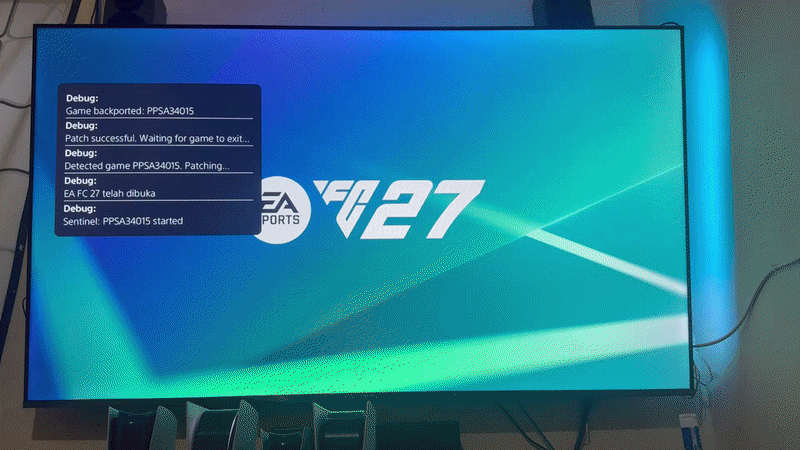

# PS5 FC27 Squad Updater



Standalone PS5 payload that detects `PPSA34015`, downloads the current PS5
roster from EA, and updates the local Squad save before the game continues.

When the save folder exists, it looks for a regular file beginning with
`sdimg_Squads20`. The payload copies that encrypted image to `/data`, mounts a
temporary decrypted view, patches `DATA`, re-encrypts it, then replaces the
source image only after full success.


## Usage


    1. Send `fc27-squad-updater.elf` to the console and leave it running.
    2. Open the game with title ID `PPSA34015`.
    3. Wait for `Squad update complete` before continuing into the game.


## Requirements

 - A jailbroken PS5 with payload execution. (tested on 10.01)


## Build

Requires the [PS5 Payload SDK](https://github.com/ps5-payload-dev/sdk).

```sh
make PS5_PAYLOAD_SDK=/path/to/ps5-payload-sdk
```

current repo:
```sh
make
```
The result is `fc27-squad-updater.elf`.

The Makefile uses `/opt/ps5-payload-sdk` when present. Otherwise it uses the
same prebuilt PS5 Payload SDK release layout used by Garlic SaveMgr. On macOS,
`LLVM_BIN` points to Homebrew LLVM 17. Set a release version with
`make VERSION=1.82b`.

```
nc <PS5 IP ADDRESS> <PS5 IP PORT> < fc27-squad-updater.elf
```
## FC27 Squad Middleware
Server-side service that fetches the latest PS5 roster from EA, decodes it,
wraps it into the FCBCHUNKS squad container, and serves it to the PS5 payload's
web UI.

## Endpoints

| Method | Path                | Description                                   |
|--------|---------------------|-----------------------------------------------|
| GET    | `/v1/squads/check`  | Returns `{version, update}` (needs `X-FC27-Version` header) |
| GET    | `/v1/squads/download` | Returns the wrapped FCBCHUNKS squad file (`X-FC27-Version` in response) |
| GET    | `/` `/logo.svg`     | Static landing page                          |

## Requirements

- Python 3
- Outbound HTTPS access to `eafc27.content.easports.com`

## Run locally

```sh
python3 app.py
# listens on 127.0.0.1:3033 by default
Environment variables:
Variable	Default
FC27_HOST	127.0.0.1
FC27_PORT	3033
FC27_CACHE_DIR	/opt/middleware/cache
Deploy to VPS
1. Copy app.py, index.html, logo.svg to /opt/middleware/.
2. Install the systemd unit fc27-squad-middleware.service and enable it.
3. Use Nginx and HTTPS vhost (Let's Encrypt).

Point the payload at a different endpoint
The payload web UI has a single URL constant. Edit html/index.html:
const MIDDLEWARE = 'https://fc27.imanrep.tech';
Change it to your local/custom middleware, e.g. http://127.0.0.1:3033 or
https://your-domain.example, then rebuild.
```
## Credits

[john-tornblom](https://github.com/john-tornblom) — [ps5-payload-sdk](https://github.com/ps5-payload-dev/sdk/) and [elfldr](https://github.com/ps5-payload-dev/elfldr)
[earthonion](https://github.com/earthonion) — [Garlic Save Manager](https://github.com/earthonion/garlic-savemgr)
[xAranaktu](https://github.com/xAranaktu/FIFASquadFileDownloader) — [FIFA Squad File Downloader](https://github.com/xAranaktu/FIFASquadFileDownloader)